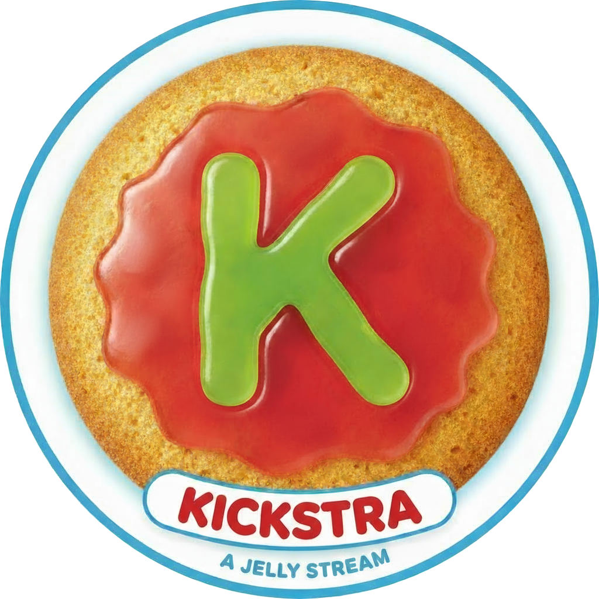
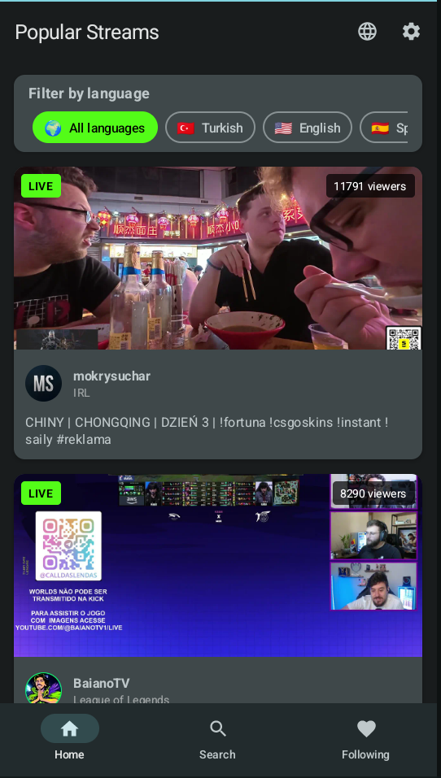
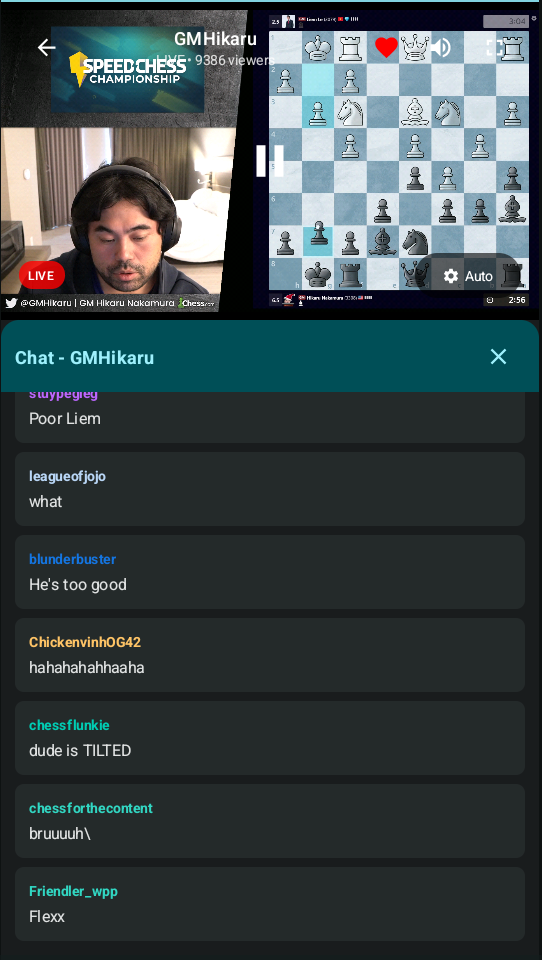
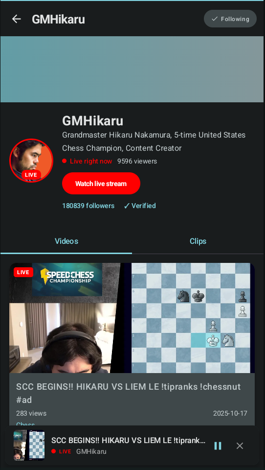
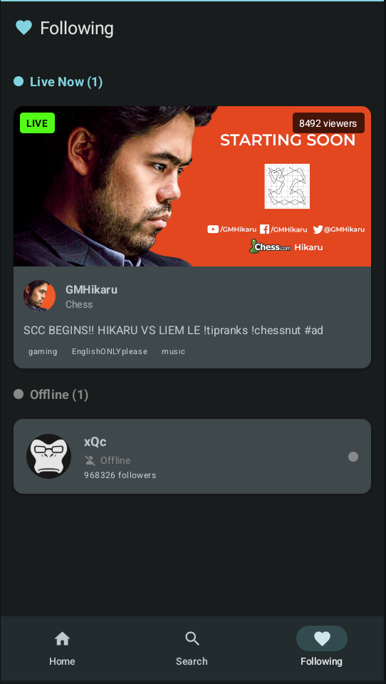

<p align="center">
  
</p>

# Kickstra

Kickstra is a native Android app that brings Kick.com livestreams and video-on-demand to an Android-first experience. It combines modern Jetpack Compose UI, Media3 playback, and a clean architecture codebase tailored for experimentation, debugging and extending Kick’s public APIs.

## 📸 Screenshots

| Home                                   | Player                                   |
| -------------------------------------- | ---------------------------------------- |
|  |  |

| Channel                              | Following                                  |
| ------------------------------------ | ------------------------------------------ |
|  |  |

## ✨ Feature overview

- **Live streams with rich controls** – Browse the popular feed, jump into a livestream, switch quality (Auto/1080p/720p/etc.), toggle fullscreen, scrub back to live, and surface chat history on demand. Controls fade automatically and respect device orientation.
- **Mini player, background playback, and PiP** – Leaving the player keeps the stream alive: a persistent mini player appears above the bottom nav, Picture‑in‑Picture engages when requested, and a media notification advertises the current session.
- **Channel profiles that feel complete** – View channel stats, follow/unfollow (persisted locally), inspect recent videos with watch-progress indicators, and filter clips by popularity or recency with endless pagination.
- **Video-on-demand playback** – Resume from the last position, swap qualities without losing progress, mark completion, and rely on watch history stored on-device.
- **Powerful search & discovery** – Debounced, multi-index search (channels, categories, tags) powered by Typesense mirrors kick.com’s behaviour, complete with loading/error states and navigation to channel profiles.
- **Following hub** – A dedicated tab surfaces recently followed channels using DataStore-backed preferences and reuses live player navigation.

## 🧱 Architecture & tech stack

- **Clean architecture** with explicit `data`, `domain`, and `presentation` layers plus use cases for business flows.
- **Jetpack Compose + Material 3** for all screens, bottom navigation, and modal surfaces.
- **Hilt** powers dependency injection across activities, view models, repositories, and playback managers.
- **Media3 / ExoPlayer** handles HLS playback (live + VOD), quality switching, and PiP.
- **Retrofit & OkHttp** with a shared client, custom headers, and in-memory cookie jar that satisfy Kick’s anti-bot checks.
- **Coroutines & Kotlin Flow** drive reactive state, pagination, and background updates.
- **DataStore & SharedPreferences** persist following lists, watch history, onboarding preferences, and notification onboarding state.
- **Coil** covers async image loading for posters, thumbnails, and avatars.

## 📂 Project layout

```
app/src/main/java/com/kickstra/
├── data/
│   ├── dto/                 # Network models returned by Kick endpoints
│   ├── local/               # FollowPreferences, VideoWatchHistoryManager
│   ├── mapper/              # DTO ↔ domain transformations
│   ├── parser/              # M3U8 parsing utilities & stream quality helpers
│   ├── remote/              # Kick + search Retrofit services, cookie jar
│   └── repository/          # Concrete repository implementations
├── domain/
│   ├── model/               # Pure Kotlin domain models (LiveStream, ChannelVideo…)
│   ├── repository/          # Repository contracts consumed by use cases
│   └── usecase/             # Application-level interactors (search, follow, etc.)
├── presentation/
│   ├── home/                # Popular feed + pagination + pull-to-refresh
│   ├── following/           # Followed channels backed by DataStore
│   ├── search/              # Typesense multi-search UI and state machine
│   ├── channel_profile/     # Channel header, videos, clips, follow button
│   ├── player/              # Live stream experience with chat overlay + controls
│   ├── video_player/        # VOD playback, PiP hooks, notifications, quality swap
│   ├── clip/                # Lightweight clip playback surface
│   ├── shared/              # SharedDataViewModel, mini-player content state
│   ├── components/          # Reusable Compose widgets
│   └── MainActivity.kt      # Nav host, PiP integration, permission UX
├── di/                      # Hilt modules wiring clients, repositories, use cases
└── ui/theme/                # Material 3 theme, typography, colors

assets/                      # Branding assets consumed in UI or launcher icons
docs/                        # Product brief, search notes, test results, mock data
```

## 📡 API integrations

- `https://web.kick.com/api/v1/livestreams` – Popular livestreams with cursor-based pagination and optional language filter.
- `https://web.kick.com/api/v1/chat/{channelId}/history` – Chat history snapshot rendered alongside the live player.
- `https://kick.com/api/v2/channels/{username}` – Channel profile metadata, live status, follower counts, banners.
- `https://kick.com/api/v2/channels/{username}/videos` – VOD catalogue used for the video tab and player detail screen.
- `https://kick.com/api/v2/channels/{username}/clips` – Clips endpoint with sort/time filters plus pagination cursors.
- `https://search.kick.com/multi_search` – Typesense-backed multi-index search covering channels, categories, and tags. A public API key is bundled in `KickSearchApi.kt`; replace it if Kick rotates credentials.

All requests share a hardened OkHttp client that injects the desktop headers and retains cookies so Kick responds as if the app were a browser.

## 🚀 Getting started

### Prerequisites

- Android Studio Hedgehog (2023.1.1) or newer
- Android SDK Platform 34 & build tools
- A device/emulator running API 24+ (hardware H.264 decoding recommended for smooth HLS playback)

### Clone & run

1. Clone the repository and open it in Android Studio.
2. Let Gradle sync dependencies (Gradle 8.2 wrapper, Kotlin 1.9.20, Compose BOM 2023.10.01).
3. Build a debug APK:
   ```bash
   ./gradlew :app:assembleDebug
   ```
4. Install/run on a physical device for the best playback fidelity. The app works without additional secrets; search uses the bundled Typesense key.

### Optional configuration

- **Notifications** – Android 13+ devices prompt for POST_NOTIFICATIONS. Accept to see playback controls while backgrounded.
- **Launcher icon optimization** – The Gradle task `optimizeLauncherIcon` automatically compresses/rewrites the branding asset during `preBuild` (requires optional `cwebp`).
- **Search headers** – If the Typesense key changes, update `KickSearchApi.kt` or move the value to a secure property before release builds.

## 🧪 Verification and tooling

- Assemble without tests: `./gradlew --no-daemon :app:assembleDebug -x test`
- Run unit tests: `./gradlew test`
- Lint & static analysis: `./gradlew lint`
- Convenience script: `./validate_project.sh` wraps assemble + lint checks.
- API smoke testing: `./test_api.sh` hits Kick endpoints with the same headers the app supplies (requires `curl` + `jq`).

## ⚠️ Known limitations & next steps

- Authentication isn’t implemented; follow/unfollow is stored locally and does not sync with Kick accounts.
- Chat is read-only via history snapshots; real-time participation/websocket chat is a future enhancement.
- Download/offline playback is out of scope.
- Error copy is mostly developer-facing; polish and localization remain to be done.
- Additional automated UI tests would improve confidence around navigation and player state changes.

## 📄 License

This project is currently shared for educational and experimental purposes only.
